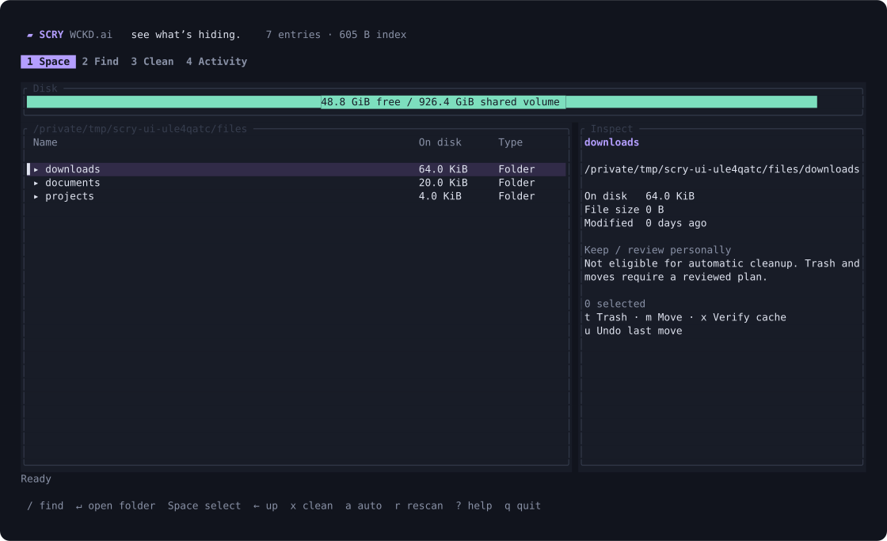

# Axit

**Find it. Axit.** A WCKD.ai terminal tool for macOS and Linux. Home: [axit.sh](https://axit.sh).

AXIT combines indexed filename search, a storage browser, file organization and guarded
cache cleanup in a small Rust binary. Everything runs locally. No account, model,
telemetry, network service or file-content indexing is required.



AXIT's **Copper** palette uses `#D9966B` for its identity and navigation, charcoal
and graphite surfaces, chalk text, cool blue information and rose destructive actions.
[View the palette](assets/palette.svg). Runtime colors live in `src/tui/theme.rs`;
text and action colors have automated contrast checks.
The split-pixel mark in the app's top-left corner and website icon shares one 8×8 source
mask, [assets/mark.txt](assets/mark.txt). Two block fragments and a diagonal cut form the 8×8 mark, in one foreground color.
Run `python3 scripts/render-logo.py` after
editing it; site checks verify both generated SVGs match.

## Project status

[Plane: Axit / AXIT](https://app.plane.so/wckd/projects/21757fa0-759f-4ce5-a114-4620fd693302/issues/)
tracks current work and the roadmap. [Axit 0.3.1](https://github.com/wckdboy/axit/releases/tag/v0.3.1)
is released with Copper branding, a clickable storage map, explicit two-button
confirmation, navigation focus and bounded background workers.
The 0.3.2 candidate adds arrow-key navigation, a split-pixel mark and a 48×16
minimum layout with a visible Find result. Publication is pending.
[axit.sh](https://axit.sh) is live on Cloudflare using the shared WCKD layout and
the standard [Wrangler workflow](site/README.md).

[Source CI](https://github.com/wckdboy/axit/actions/runs/40155268098) passed 65 Rust
tests and 88 MCP/ACP checks on macOS, and 62 Rust tests and 89 protocol checks on
Linux, plus installer/tamper, PTY and site checks. The
[release workflow](https://github.com/wckdboy/axit/actions/runs/40155596892) built all
four targets and tested the native Apple Silicon and Linux musl packages. The
published Intel Mac package also passed protocol, installer and PTY checks through
Rosetta. The README and Plane are updated alongside verified releases.

The 0.3.2 CodeRabbit CLI review reports zero findings. Its GitHub suggestions
about release attribution and preserving same-view scroll position are fixed.

Next in Plane: incremental filesystem updates (`AXIT-5`) and bounded pagination
for more than 1,000 search/folder results (`AXIT-6`). Both remain planned work.
An application manager with reviewed uninstall, related-file discovery and native
package-manager installation is in progress (`AXIT-15`).

## Install

Release packages support Apple Silicon, Intel Macs, Linux ARM64 and Linux x86-64.
Linux packages are statically linked with musl. The installer checks SHA-256 before
installing to `~/.local/bin`; it does not modify your shell configuration or run a scan.

```sh
curl -fsSL https://axit.sh/install.sh | sh
axit
```

Release downloads need no Rust toolchain or GitHub sign-in. The same installer is
available from [GitHub Releases](https://github.com/wckdboy/axit/releases/latest/download/install.sh).
From an existing checkout, you can also run `sh install.sh`.

From a source checkout with Rust 1.88 or newer:

```sh
sh install.sh --local
```

Set `AXIT_INSTALL_DIR` to change the install location, or `AXIT_VERSION=v0.3.1` to pin
a release. Re-run the installer to upgrade. No sudo is needed for installation.

Renamed from SCRY: existing private indexes, cleanup preferences and the undo journal
are reused in place when no Axit store exists. No index copy is needed.
Legacy `SCRY_STATE_DIR`, `SCRY_TRASH_DIR` and installer variables remain accepted;
the `AXIT_*` equivalents take precedence. MCP advertises `axit_*` tools and accepts
the previous `scry_*` names for existing clients.

## Use

```sh
axit                               # TUI; creates an index on first launch
axit --root "$HOME" scan            # refresh your home index
axit --root /System/Volumes/Data scan  # all reachable Mac Data-volume files
axit search 'ext:pdf size:>100mb'
axit search 'path:projects !target re:report.*2026' --sort modified
axit browse                        # largest children of the index root
axit status                        # free space, index size and coverage
axit doctor                        # physical volumes and access failures
```

TUI keys:

- `1` Space, `2` Find, `3` Clean, `4` Activity keeps focus on navigation, so
  repeated number shortcuts never get trapped in a text field. `Enter` enters a section.
- `Alt-1…4` works even in text fields and dialogs. `Ctrl-Tab` /
  `Ctrl-Shift-Tab` switches sections; `Ctrl-PageDown/Up` is an alternative for terminals
  that intercept those keys. Switching sections safely cancels a pending review.
- `F6` toggles navigation/content focus. In navigation, arrows choose a section and
  `Enter` or `Down` enters it. `/` or `Ctrl-F` edits search; plain digits remain text there.
- `Up` at the first row, search field or top of a panel returns to navigation.
  `Left` / `Right` then changes sections; `Down` returns to content. `Ctrl-Up`
  jumps straight to navigation, safely canceling any pending review.
- `Tab` / `Shift-Tab` cycles navigation, query, results, inspector and action buttons.
  Arrow keys choose a focused button; `Enter` activates it.
- Arrow keys or `j/k` navigate; `Home` / `End` jumps; `PageUp` / `PageDown` moves a page.
- `Enter` opens a folder or inspects a file; `Backspace` goes up. `Alt-Left` /
  `Alt-Right` retraces history; `Alt-Up` goes up; `Alt-Home` returns to the scope root.
- `Space` toggles a mark, `Shift-Up/Down` selects a range, `Ctrl-A` marks the listed
  items, and `Esc` clears marks. Marks do not carry into another folder or query.
- `Delete` / `t` previews Trash, `m` previews a move, `x` verifies a disposable cache.
- `u` undoes a reversible move, `a` configures automatic cleanup, `r` rescans.
- `s` sorts the current list; `p` shows an item's containing folder; `g` toggles the Space map.
- `?` opens scrollable help; `q` / `Ctrl-Q` quits. An in-progress file operation
  finishes before exit; canceling a preview never changes files.

The minimum terminal size is 48 columns × 16 rows; smaller windows show a resize hint.

Mouse and touchpad:

- Click tabs, breadcrumbs and action buttons. Buttons activate on release.
- Click a row to focus it; double-click to open/inspect; right-click for item actions.
- Click a storage-map tile to select its row; double-click a folder tile to enter it.
- Click `[ ]` or Ctrl-click to toggle marks; Shift-click or drag selects a range.
- Wheel / touchpad scrolling works in lists, the inspector and dialogs. The scrollbar
  supports clicking and dragging.
- A deletion opens a reviewed plan with Cancel selected. Click its explicit action
  button, or use Tab then Enter. Escape cancels; typing and paste never confirm a dialog.

Search and destination fields support cursor editing, Unicode, horizontal scrolling
and bracketed paste. `Ctrl-A/E` moves to the start/end; `Ctrl-U` clears the field.
Background scans preserve your current input focus and query.
Mouse input requires a terminal that forwards mouse events. Use your terminal's
selection modifier (commonly Shift) to select and copy text normally.

Completed operations update rows immediately. Undo restores them without forcing a
full disk scan when the original path is still indexed. If you have rescanned since
the move and its original path is absent, Undo starts a background refresh so the
restored file reappears. A notice identifies stale indexed sizes; press `r` when ready to
refresh. The current folder and cursor survive a refresh. A small private
`tui-state.json` remembers removed rows for the matching index generation.

Search supports quoted terms, `*.zip` wildcards, `!excluded`, `re:expression`,
`ext:pdf;png`, `type:file`, `type:dir`, `size:>2gib`, `older:30d` and `path:project`.
Plain terms use case-insensitive ASCII matching. Terms are combined with AND.
Size filters use allocated disk space. `gb` is decimal; `gib` is binary.

## Understand the numbers

The volume meter reports filesystem free space separately from indexed folder totals.
The Space map compares the largest eight direct children with all remaining children
grouped as Other items. These are disjoint child estimates, with sizes taken from
the index. Refresh after filesystem changes. `g` hides the map for a taller file list.
Folder sizes include descendants, so parent and child rows overlap. Hardlinks count
once; APFS clones can share blocks. Sparse files can have large logical sizes and
small allocated sizes. An allocated-size estimate is not a promise of recovered space.

Scans visit every reachable entry within the selected filesystem. They include hidden
files, do not follow symlinks, skip other mounted filesystems and exclude AXIT's own
state directory. Restricted/missing locations are counted and listed under Activity
and in `latest-scan.json`. On macOS, grant your terminal Full Disk Access for protected
locations. Administrator access alone does not remove macOS privacy restrictions.

For a complete physical-drive view, combine the Data-volume browser with `axit doctor`:
APFS boot, recovery, preboot and swap volumes share storage with your files. Mounted
simulator images are separate views of backing files, rather than additional capacity.

## File operations

Every operation starts with a preview. Nothing selected is moved or removed when a
plan is created. The TUI asks a specific question, shows paths and consequences,
and defaults to Cancel. Confirm its explicit action button to proceed.
CLI and MCP calls require the exact confirmation phrase (`CLEAN`, `TRASH` or `MOVE`).
Plans expire after ten minutes and recheck file identity and active processes.
An apply result with `needs_reconcile: true` identifies an error after paths changed.
The TUI preserves a stale-index notice across restarts; refresh before retrying.

```sh
axit plan 12345 --action clean
axit apply PLAN_ID --confirm CLEAN
axit plan 54321 --action move --to "$HOME/Documents/organized"
axit apply PLAN_ID --confirm MOVE
axit undo
```

Moves atomically refuse to replace an existing file. Moves and Trash are reversible
through the local journal; moving to Trash does not release space until Trash is emptied.
Permanent cleanup is limited to recognized generated cache directories. It requires
ownership, cache/project markers, Git-ignored status where applicable, no tracked
source, age checks and no current-user active files/builds. Cache fingerprints are
checked before and after an exclusive claim. Source markers, releases, archives,
signing files, model weights, symlinks and special files block permanent cleanup.
Whole Rust target directories are never permanently cleaned. This preserves custom
release profiles and packages with unfamiliar extensions. Debug and incremental
compiler caches can be cleaned independently.
Shared external Rust targets are left for manual review.

`lsof` is required for file mutations. If process inspection fails, mutations are blocked;
scanning and search remain available. Unusual control-character/non-UTF-8 filenames
remain searchable; mutation of those names is delegated to the system file manager.

## Automatic space saving

Automatic cleanup is **off by default**. Enable it for explicit project/cache roots in
the TUI, or configure it from the CLI:

```sh
axit auto --enable --allow "$HOME/projects/example"
axit auto --run
axit auto --watch                   # check every five minutes while this command runs
axit auto --disable
```

Defaults: only below 20 GiB free; minimum age seven days; at most 2 GiB removed per
run; at most once a day. Entire home and disk roots are rejected. The TUI checks once
a minute while open. `auto --watch` runs in the foreground; no background service is
installed automatically. Each automatic run uses the same verification rules and
journal as manual cleanup.
An empty or fully blocked check can retry after five minutes without consuming the
daily allowance. A batch accepts at most 16 caches within the verified byte budget;
oversized entries are skipped so smaller eligible caches can fit. Candidate metadata
is reused, but every destructive claim gets fresh process and identity checks.
Unavailable and out-of-scope roots are skipped without losing saved preferences.
Blocked automatic previews are not persisted, so retries do not accumulate empty plans.

## MCP

```sh
axit mcp --root "$HOME"
```

Example MCP client configuration:

```json
{
  "mcpServers": {
    "axit": {
      "command": "axit",
      "args": ["mcp", "--root", "/home/you"]
    }
  }
}
```

Tools: `axit_status`, `axit_scan`, `axit_search`, `axit_browse`, `axit_cleanup_plan`,
`axit_move_plan` and `axit_trash_plan`. Scans run in the background; poll status.
The launch scope is fixed. Mutations are disabled and unadvertised by default.
Explicit `--allow-mutations` adds annotated apply/undo tools; clients must obtain
user approval for destructive calls. Plans still require exact confirmation and live
revalidation. The server uses bounded newline-delimited stdio JSON-RPC, accepts at
most four active requests, and supports search cancellation.

## ACP

```sh
axit acp --root "$HOME"
```

This Agent Client Protocol v1 adapter exposes deterministic metadata commands:
`/search QUERY`, `/largest`, `/status`, `/scan` and `/plan ID…`. Sessions are scoped to
their working directory within the server's launch scope. Results stream as agent
message chunks. No language model runs inside AXIT. File execution stays in the TUI
or explicitly enabled MCP tools. External MCP servers and conversation history are
not advertised or launched by this adapter.

## Design and resource budget

- Streaming filesystem traversal and fixed-width, little-endian records.
- Original filenames and parent ids stored once; no database server or full-path index.
- Immutable generations are memory mapped for search and published atomically.
- One search worker and one listing worker run outside the UI thread. Superseded
  requests are canceled and coalesced to the latest request.
- A 32-entry generation-aware listing cache keeps folder revisits fast; cache
  candidate hints are shared for each immutable index. Neither certifies deletion.
- At most 1 GiB per index; refreshing keeps the previous generation plus up to
  2 GiB of temporary construction space until publication completes.
- Previous complete index survives cancellation, invalid output or a failed rebuild.
- Private state directory permissions are `0700`; index and operation records are private.

State defaults to `~/Library/Application Support/ai.wckd.axit` on macOS and
`$XDG_STATE_HOME/axit` or `~/.local/state/axit` on Linux. Override with `--state-dir`
or `AXIT_STATE_DIR`. File contents and credentials are never included in the index.
`AXIT_TRASH_DIR` selects a dedicated recovery root instead of the system Trash; it is
also used by isolated integration tests. Files stay inside its `files/` directory;
Linux metadata stays inside its `info/` directory. Recovery directories must be owned
and private (`0700`); AXIT rejects publicly accessible destinations without changing
their permissions. The operation journal provides undo.

On the development Mac, a 5.98-million-entry index used 490 MiB on disk. Seven
representative searches took 20–181 ms (median of three runs each) over a persistent
MCP connection. The initial metadata scan took 297 seconds, including access errors
and cloud-file timeouts. These are measurements from one busy machine; filesystem,
query and storage performance affect results.

A read-only 0.3 benchmark on the Mac's current 5.52-million-entry index found 1,208
cache hints in 26 ms. Dispatching a cold folder load took 52 µs; section-switch
handlers took at most 21 µs while that load ran. These measure metadata discovery
and event dispatch, not complete frame latency. The benchmark reuses an existing
index and never scans or mutates indexed files:

```sh
AXIT_BENCH_STATE=/path/to/existing/state cargo test --release --locked --jobs 2 \
  benchmark_existing_index_navigation -- --ignored --nocapture
```

## Build and verify

```sh
cargo fmt --check
cargo clippy --all-targets --locked --jobs 2 -- -D warnings
cargo test --locked --jobs 2 -- --test-threads=1
cargo build --release --locked --jobs 2
python3 scripts/protocol-test.py target/release/axit
sh scripts/installer-test.sh target/release/axit
python3 -m venv .venv-ui
.venv-ui/bin/pip install pyte==0.8.2
.venv-ui/bin/python scripts/tui-test.py target/release/axit
```

The release workflow packages all four targets and SHA-256 manifests. It tests the
native Apple Silicon and both Linux musl release binaries with the protocol,
installer and PTY suites; Intel Mac packages are also exercised locally under
Rosetta. The standard Check workflow runs on macOS and Linux, including site checks.
Run `npm --prefix site run check` to build and verify the website independently.
Development and test builds disable incremental compilation and debug information to limit local
build storage. Filesystem mutation tests operate only on temporary fixtures.

AXIT is an independent MIT-licensed implementation inspired by
[FSearch](https://github.com/cboxdoerfer/fsearch)'s indexed-search interaction model.
Protocol references: [MCP tools](https://modelcontextprotocol.io/specification/2025-11-25/server/tools)
and [Agent Client Protocol v1](https://agentclientprotocol.com/protocol/v1/overview).
